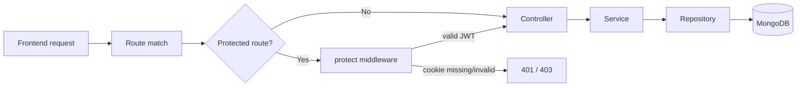
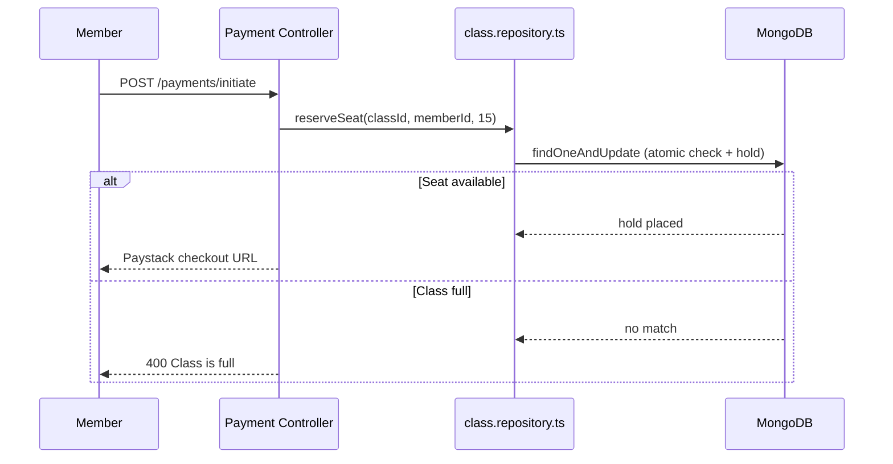
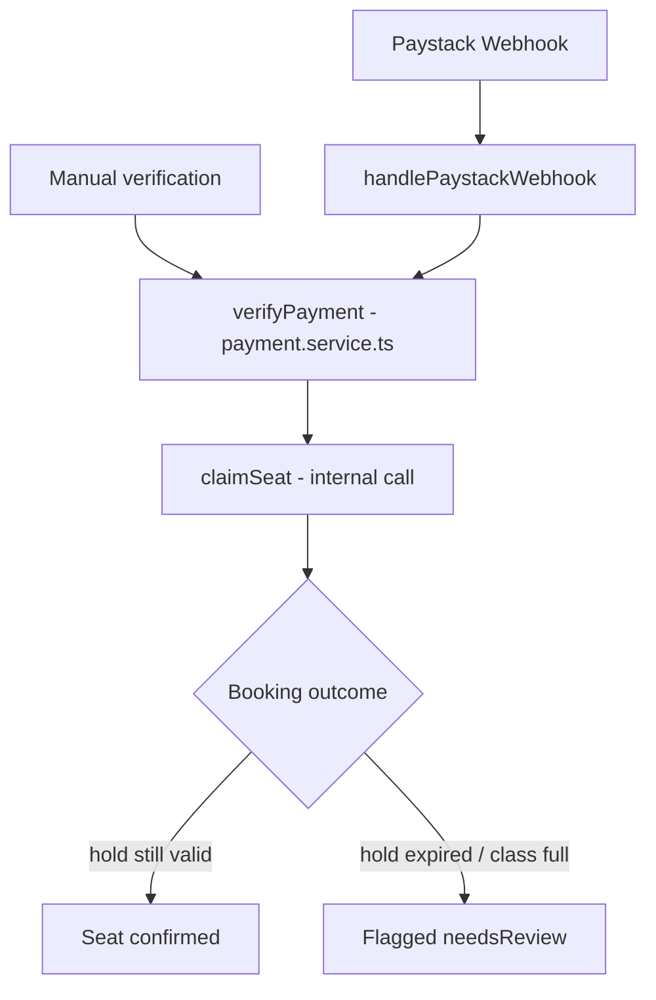

# Gym Ontime — Backend

REST API for a gym management platform. Admins run the gym, trainers run classes, and members book and pay for them. Built with Express, TypeScript, and MongoDB.

The companion frontend lives in a separate repo: [`Gym_Ontime`](https://github.com/Dev-Jabbar/Gym_Ontime) (live at https://gym-ontime.vercel.app).

> **Two backends, one frontend.** The same API (same `/api/...` paths) was later rebuilt on NestJS + PostgreSQL in [`gym_ontime_nestjs_backend`](https://github.com/Dev-Jabbar/gym_ontime_nestjs_backend). The frontend has a switch to use either. This repo is the original Express + MongoDB version, hosted on Render's free tier (it sleeps when idle, so the first request can take up to a minute): `https://gym-ontime-backend.onrender.com/api`.

## Table of Contents

- [Tech Stack](#tech-stack)
- [Getting Started](#getting-started)
- [Project Structure](#project-structure)
- [Architecture](#architecture)
- [API Reference](#api-reference)
- [Background Jobs](#background-jobs)
- [Known Limitations](#known-limitations)
- [Documentation](#documentation)
- [Contributing, Security and License](#contributing-security-and-license)

## Tech Stack

| Layer | Choice |
|---|---|
| Runtime | Node.js + TypeScript |
| Framework | Express |
| Database | MongoDB (Mongoose) |
| Auth | JWT, stored in an HTTP-only cookie |
| Payments | Paystack (one-time and recurring subscriptions) |
| Scheduled jobs | `node-cron` |
| Image uploads | Cloudinary |

## Getting Started

```bash
# Install dependencies
yarn install

# Create your env file and fill in real values (the variables are listed below;
# .env.example holds the same names with placeholder values)
cp .env.example .env

# Run the dev server (auto-restarts on change)
yarn dev
```

### Environment Variables

| Variable | Purpose |
|---|---|
| `PORT` | Port the server listens on |
| `MONGO_URI` | MongoDB connection string |
| `JWT_SECRET` | Secret used to sign/verify login tokens |
| `JWT_EXPIRES_IN` | Token lifetime, e.g. `7d` |
| `PAYSTACK_SECRET_KEY` | Server-side Paystack key — verifies payments and webhook signatures. Never exposed to the client. |
| `FRONTEND_URL` | The frontend's address. After checkout Paystack sends the browser to `${FRONTEND_URL}/payment-success` (required to start a payment). Locally `http://localhost:4000`. |
| `CLOUDINARY_CLOUD_NAME` / `CLOUDINARY_API_KEY` / `CLOUDINARY_API_SECRET` | Image upload signing |

CORS is configured in `src/index.ts`, which allows `http://localhost:3000`, `http://localhost:4000` and `https://gym-ontime.vercel.app` (with credentials). Add your own origin there if you host the frontend elsewhere.

### Other Scripts

```bash
yarn build       # Compile TypeScript to dist/
yarn start       # Run the compiled build (production)
yarn seed:admin  # Seed an initial admin user
```

## Project Structure

Layered architecture: each folder has exactly one job, and a request always flows through them in the same order.

```
src/
├── routes/         # URL → handler mapping. No logic lives here.
├── middleware/      # Cross-cutting checks that run before a controller (auth, etc.)
├── controllers/     # Parses the request, calls a service, shapes the response.
├── services/        # Business rules. The only layer allowed to make decisions.
├── repositories/     # The only layer allowed to talk to MongoDB.
├── models/          # Mongoose schemas.
├── webhooks/         # Handlers for incoming calls from third parties (Paystack).
├── jobs/            # Scheduled background sweeps (node-cron).
├── validations/      # Request-body schemas (Zod).
├── utils/           # Small stateless helpers (JWT signing/verification, etc.)
├── config/          # Environment-driven configuration (DB connection, JWT options).
└── errors/          # Shared error types.
```

A bug in "talking to the database" can't hide inside "business rules" code, because those two things are never in the same file.

## Architecture

### Request lifecycle



### Seat reservation — the core booking flow

Booking a class doesn't just check "is there room" and hope nothing changes in the next few seconds — see [`reserveSeat` in `class.repository.ts`](./src/repositories/class.repository.ts) for the full breakdown of why this is a single atomic database operation rather than a check-then-write pair.



### Payment verification — one shared path, two triggers

Both the Paystack webhook and the frontend's manual "did it work" check converge on the exact same function. There is only one implementation of "what happens when a payment succeeds" in the entire codebase.



See [`docs/ARCHITECTURE.md`](./docs/ARCHITECTURE.md) for the full breakdown of every state this can resolve to.

## API Reference

All routes are mounted under `/api`. Routes marked 🔒 require a valid session cookie; a role in brackets means only that role may call it.

### Users — `/api/users`
| Method | Path | Access |
|---|---|---|
| POST | `/register` | Public |
| POST | `/login` | Public |
| POST | `/logout` | Public |
| GET | `/me` | 🔒 Any |
| GET | `/` | 🔒 admin |
| POST | `/:id/upgrade-to-trainer` | 🔒 admin |
| GET | `/:id` | 🔒 Any |
| PUT | `/:id` | 🔒 Any |
| DELETE | `/:id` | 🔒 admin |

### Classes — `/api/classes`
| Method | Path | Access |
|---|---|---|
| GET | `/` | Public |
| GET | `/:id` | Public |
| GET | `/:id/member-count` | Public |
| GET | `/:id/members` | 🔒 trainer, admin |
| GET | `/by-member/:memberProfileId` | 🔒 admin |
| POST | `/` | 🔒 admin |
| PUT | `/:id` | 🔒 admin |
| DELETE | `/:id` | 🔒 admin |
| POST | `/:id/members/:userId` | 🔒 admin |
| DELETE | `/:id/members/:userId` | 🔒 admin |
| PUT | `/:id/trainer/:userId` | 🔒 admin |

### Payments — `/api/payments`
| Method | Path | Access |
|---|---|---|
| POST | `/webhook` | Public (Paystack signature-verified) |
| POST | `/initiate` | 🔒 member |
| GET | `/verify` | 🔒 member |
| GET | `/my-payments` | 🔒 member |
| GET | `/class/:classId` | 🔒 admin |
| GET | `/` | 🔒 admin |
| GET | `/:id` | 🔒 admin |

### Member Profiles — `/api/members`
| Method | Path | Access |
|---|---|---|
| GET | `/` | Public |
| GET | `/:id` | Public |
| POST | `/profile` | 🔒 member |
| GET | `/me` | 🔒 member |
| PUT | `/me` | 🔒 member |
| DELETE | `/me` | 🔒 member |

### Trainer Profiles — `/api/trainers`
| Method | Path | Access |
|---|---|---|
| GET | `/` | Public |
| GET | `/:id` | Public |
| POST | `/profile` | 🔒 trainer |
| GET | `/me` | 🔒 trainer |
| PUT | `/me` | 🔒 trainer |
| DELETE | `/me` | 🔒 trainer |
| GET | `/my-classes` | 🔒 trainer |

### Admin Profile — `/api/admins`
| Method | Path | Access |
|---|---|---|
| GET | `/me` | 🔒 admin |
| PUT | `/me` | 🔒 admin |

(The NestJS rebuild locks the member and trainer list routes down; this Express version leaves them public.)

### Notifications — `/api/notifications`
| Method | Path | Access |
|---|---|---|
| GET | `/my-notifications` | 🔒 Any |
| PUT | `/:id/read` | 🔒 Any |
| PUT | `/mark-all-read` | 🔒 Any |

### Uploads — `/api/uploads`
| Method | Path | Access |
|---|---|---|
| POST | `/signature` | 🔒 Any (returns a signed Cloudinary upload signature) |

## Background Jobs

Three `node-cron` sweeps run continuously alongside the server, started from `index.ts`:

| Job | What it does |
|---|---|
| `paymentCleanup.job.ts` | Every 15 min: re-verifies stale `pending` payments directly against Paystack (24h hard cutoff), and releases every expired seat hold across all classes. |
| `subscriptionExpiry.job.ts` | Sweeps subscriptions past their `endDate`, flips them to `expired`, and removes the member from the class so they stop counting toward capacity. |
| `classReminder.job.ts` | Notifies members ahead of their next session, correctly handling recurring classes (weekly/monthly) rather than just the original anchor date. |

## Known Limitations

This is the original version of the app; the NestJS rebuild fixed several of these. They are listed here rather than hidden.

- **No automated tests and no CI.** Correctness was checked by hand. (The NestJS version has 102 unit tests, 13 real-database tests and two CI workflows.)
- **Member and trainer list routes are public** (`GET /api/members`, `GET /api/trainers` and their `/:id` routes). The NestJS version requires a login and hides sensitive fields.
- **No rate limiting and no security headers** (`helmet`) on the API.
- **CORS origins are hard-coded** in `src/index.ts`; adding a frontend domain needs a code change.
- **No health endpoint** beyond `GET /`, which only says the process is up.
- **Jobs run inside the web process** with `node-cron`: a failed run is not retried and several instances would each run every job.
- **The admin seed uses a fixed email and password** (`src/seed/admin.seed.ts`). Change the password of any admin created that way, and do not use it on a public deployment. `src/seed/create_classes.js` also holds a hard-coded admin login for local use.
- Stripe fields remain in the payment model and `stripe` in `package.json` from an earlier design; Paystack is the only provider in use.

## Documentation

| Document | What it covers |
|---|---|
| [`docs/ARCHITECTURE.md`](./docs/ARCHITECTURE.md) | Layered request flow, the seat-hold system, payment verification, subscriptions |
| [`docs/seat-reservation.md`](./docs/seat-reservation.md) | One-page flow chart of a seat from hold to confirmed, late or released |
| [`docs/DEPLOYMENT.md`](./docs/DEPLOYMENT.md) | Hosting on Render, production settings, MongoDB Atlas |

## Contributing, Security and License

- Local workflow and conventions: [CONTRIBUTING.md](./CONTRIBUTING.md)
- Reporting a vulnerability: [SECURITY.md](./SECURITY.md)
- License: [MIT](./LICENSE)
