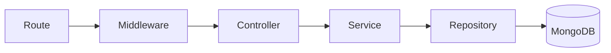
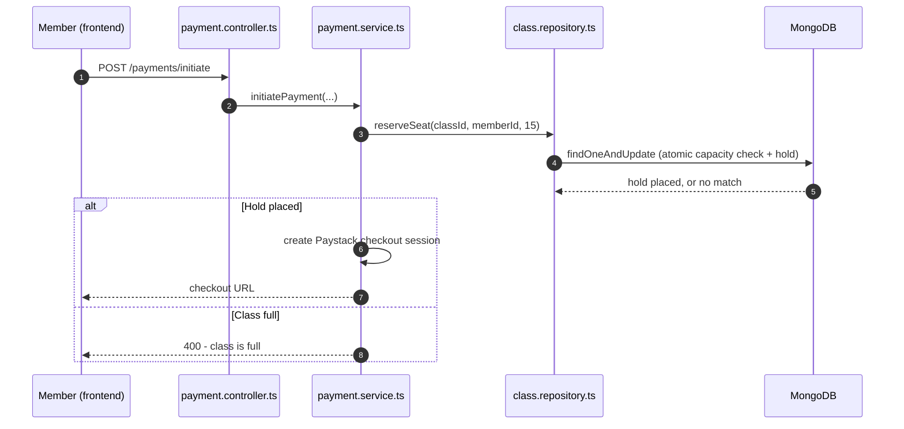
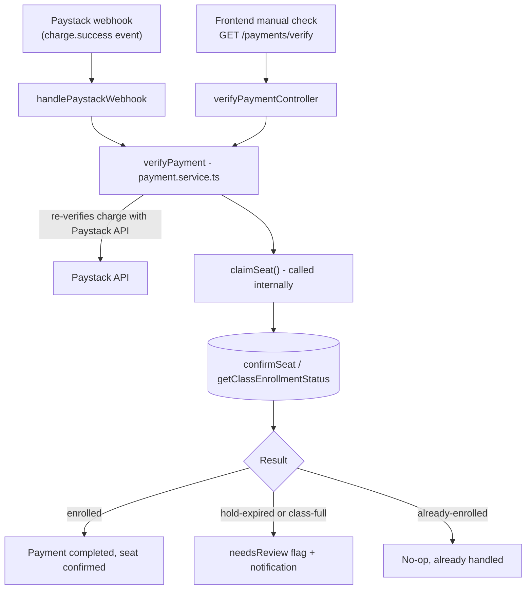

# Architecture

This document covers the two pieces of this backend worth understanding in depth: the layered request flow, and the seat-hold/payment system that sits underneath every class booking. For a full endpoint list, see the [README](../README.md#api-reference). A one-page flow chart of a seat's life is in [seat-reservation.md](./seat-reservation.md).

## Layered Request Flow

Every request that touches the database passes through four layers, always in the same order:

- **Route** — maps a URL + HTTP method to a handler. Contains no logic.
- **Middleware** (`protect(roles?)`) — reads the JWT from the `token` cookie, rejects the request with 401/403 if it's missing, invalid, or the wrong role. Only runs on routes that declare it.
- **Controller** — parses the request (body/params/query), calls the matching service function, shapes the HTTP response. Doesn't contain business rules.
- **Service** — the business logic. E.g. "is this class allowed to accept a subscription payment," or the entire seat-hold/payment-verification flow below.
- **Repository** — the only layer that constructs MongoDB queries. A service never talks to Mongoose directly.

The benefit this buys: a bug in "how do we talk to MongoDB" and a bug in "what are the business rules" can never hide in the same file, because they're never in the same file.

## The Seat-Hold System

**Why it exists:** without it, "check if the class has room" and "add the member" would be two separate steps, with an open window between them. Two people booking the very last seat at nearly the same moment could both pass the check before either write happens — a **race condition**. The fix is to make the check and the write a single atomic database operation.

### Sequence: booking a class

### Why `reserveSeat` is atomic, concretely

`reserveSeat` (in `class.repository.ts`) builds a MongoDB filter that must match **all** of the following before it's allowed to write:

1. The class exists.
2. This member isn't already a confirmed member (`members: { $ne: memberId }`).
3. This member doesn't already hold a pending spot (`pendingMembers.member: { $ne: memberId }`).
4. If the class has a set capacity: the number of confirmed members plus everyone else's *currently unexpired* holds is still less than capacity — computed with a MongoDB `$expr`/`$filter`, i.e. inside the query itself, not in application code.

`findOneAndUpdate` evaluates that filter and performs the write as one indivisible operation. If two requests arrive at nearly the same instant, MongoDB guarantees only one of them can actually succeed — the loser's filter simply no longer matches by the time it's evaluated, because the database serializes the two operations rather than running them simultaneously against the same document.

### Confirming or releasing a hold

| Function | When it's called | What it guards against |
|---|---|---|
| `confirmSeat` | Payment succeeds | Only promotes a hold to a real seat if it hasn't expired — stops a late payment from confirming into a seat that's since gone to someone else. |
| `releaseSeat` | Payment fails, or Paystack init errors after a hold was placed | Frees the seat immediately instead of leaving it locked for the full 15 minutes over nothing. |
| `releaseExpiredHolds` | Cron sweep, every 15 min | Safety net for holds nobody ever confirmed or released (e.g. an abandoned browser tab). |

## Payment Verification — One Function, Two Triggers

Paystack can notify this backend of a successful payment in two ways: its own webhook, or the frontend directly asking "did this work?" after redirecting back from checkout. Both paths call the exact same function, `verifyPayment()` in `payment.service.ts` — there is no separate, second implementation for either trigger.

**Why the webhook alone isn't enough:** Paystack only sends a webhook event for a *successful* charge — never for a failed or declined one. That means the manual verification path (triggered by the user's own post-checkout redirect, or the cleanup cron sweep) is the only place in the system that ever learns a payment failed, so it's responsible for marking it `failed` and releasing the seat hold. Relying on the webhook alone would leave failed payments stuck as `pending` forever.

**Why one shared function instead of two implementations:** this file's history is a real example of the alternative going wrong — the webhook handler used to contain its own separate copy of the seat-claiming logic, and it had already drifted out of sync (missing subscription creation that the main path had). Consolidating both triggers onto one function removed an entire class of "the two paths disagree" bugs by construction, not by discipline.

## Recurring Classes and Subscriptions

A class has a `recurrence` field (`"none" | "weekly" | "monthly" | ...`). One-off classes (`"none"`) only accept a single payment; recurring classes can additionally accept a subscription, tracked in its own `class-subscription` collection with a `status` and `endDate`. The `subscriptionExpiry.job.ts` cron sweep flips expired subscriptions to `"expired"` and removes that member from the class's `members` array, so a lapsed subscriber stops counting toward capacity.
